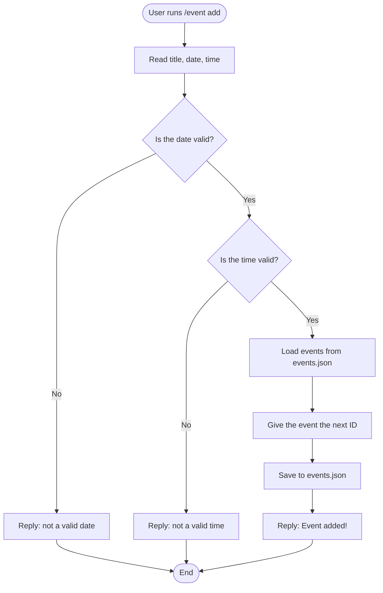
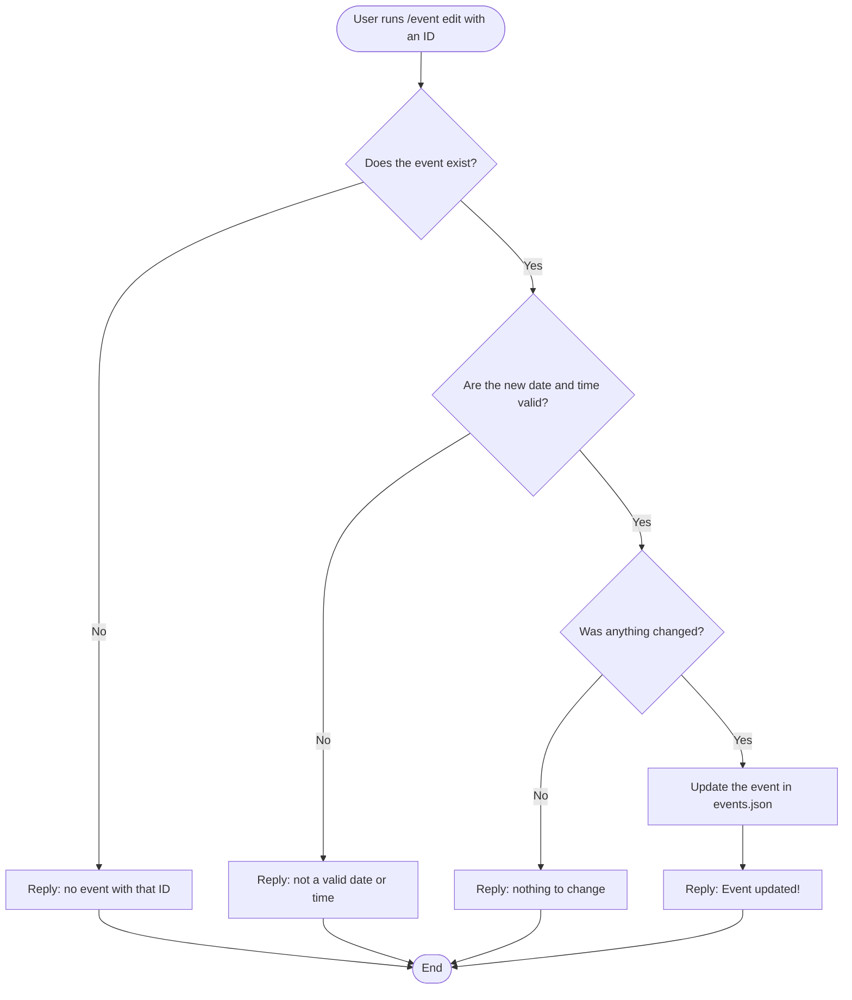
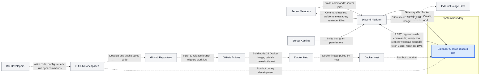
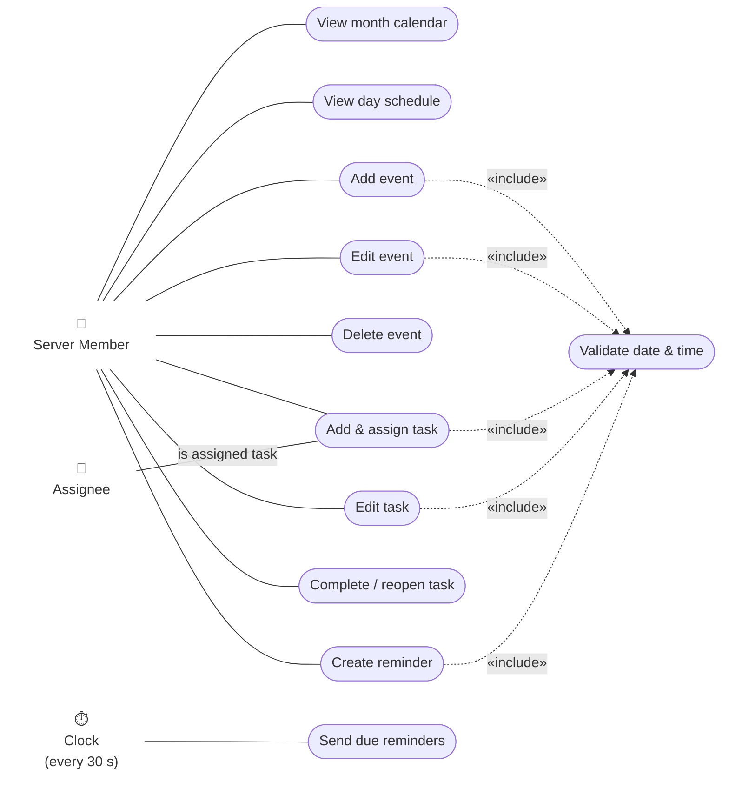
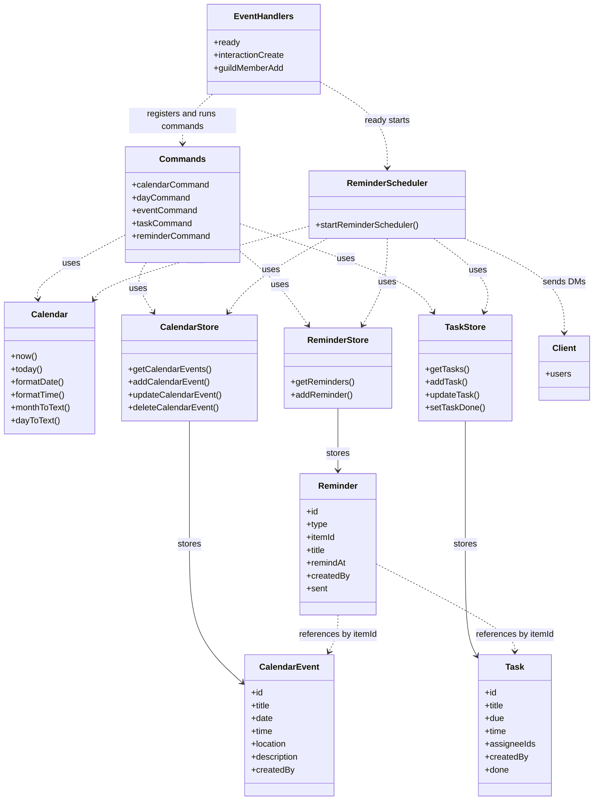
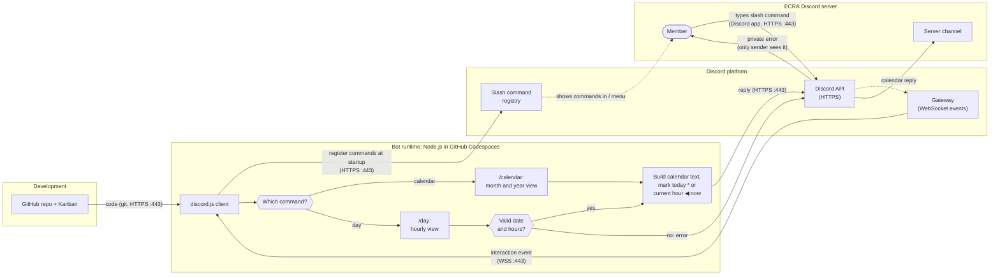

ARCHITECTURE.md file
## Activity Diagrams: Calendar Events (Hakan)

These activity diagrams show the step-by-step flow when a user runs `/event add` and `/event edit`, including each decision the bot makes.

### Activity Diagram 1: `/event add`

### Activity Diagram 2: `/event edit`

### Notes
- Diamonds are yes/no decisions. Every "No" path sends an error that only the user can see.
- Both commands check the input **before** saving, so bad data never gets into `events.json`.
- Known limit: anyone can edit any event right now. A future fix is to only let the creator or a moderator edit it.

## System Context Diagram (Zad)

**Legend:** Solid arrows represent runtime interactions. Dotted arrows represent build-time, deployment, or indirect interactions. Arrowheads indicate the direction of data or control flow.

### System Context Diagram Description

The System Context Diagram illustrates how the **Calendar & Tasks Discord Bot** interacts with external users, services, and development infrastructure. The bot is represented as a single system within its boundary, focusing on external interactions rather than internal implementation.

At runtime, **Discord serves as the primary communication interface** between server members and the bot. Users submit slash commands through Discord, which forwards interactions to the bot using Gateway events. The bot communicates through Discord's REST API to display calendars, manage events and tasks, send automated reminders, and welcome new members. Welcome messages include an image URL that Discord clients retrieve from an external image host.

The diagram also illustrates the **development and deployment process**, including GitHub Codespaces, GitHub Actions, Docker Hub, and the Docker host. **Solid arrows** represent runtime interactions, while **dotted arrows** represent development, deployment, or indirect interactions.

Local JSON files store application data within the system boundary, so no external database is shown.

## Use Case Diagram (Ilakshi)

This diagram shows how users and the system interact with the Calendar & Task Bot. All use cases are handled by the bot; actors are outside the system. Discord is the platform every interaction runs through (commands, replies, @mentions, and reminder DMs), so it isn't shown as a separate actor.

**Actors**
- **Server Member** (primary): anyone in the server who uses the bot to view the calendar and manage events, tasks, and reminders.
- **Assignee** (secondary): a server member who is assigned to a task. The bot @mentions them when the task is created.
- **Clock** (primary, time-based): the reminder scheduler checks for due reminders every 30 seconds. No user starts this use case.

**Use cases**
- **View month calendar / View day schedule** (`/calendar`, `/day`): show a month grid or a day's hour slots in Pacific time.
- **Add / Edit / Delete event** (`/event add|edit|delete`): manage calendar events by ID.
- **Add & assign task** (`/task add`): create a task with a due date, time, and one to five assignees.
- **Edit task / Complete or reopen task** (`/task edit`, `/task complete`): update a task or change its done status.
- **Create reminder** (`/reminder add`): schedule a reminder for an existing task or event.
- **Send due reminders**: DM the reminder's creator when it's due. Reminders for deleted events or completed tasks are skipped.
- **Validate date & time** («include»): every use case that creates something with a date checks that the date is a real `YYYY-MM-DD` date and the time is a valid 24-hour `HH:MM`.

## Class Diagram: Bot Structure (Sarah)

This diagram shows how the bot's command modules, storage modules, and data records connect. The bot uses JavaScript modules and plain objects instead of declared classes. `CalendarEvent`, `Task`, and `Reminder` represent objects saved as JSON in `data/`. `Commands` represents the five command modules, and `EventHandlers` represents the three event modules in `src/events/`. The other boxes represent ES modules.

**Legend:** Dotted arrows show dependencies. Solid arrows show which data records each storage module saves.

### Notes

- `ready` registers the five commands and starts the reminder scheduler. `interactionCreate` finds and runs the selected command.
- `calendarStore`, `taskStore`, and `reminderStore` save data in `events.json`, `tasks.json`, and `reminders.json` in the `data/` folder.
- Reminders use `type` and `itemId` to identify a task or event. The scheduler checks every 30 seconds, sends DMs, and skips reminders for deleted items or completed tasks.
- `Task` also stores `completedAt` when completed. `Reminder` stores `skipped` when skipped.
- **To add a command:** Create a module with `data` and `execute(interaction)`, then add it to the array in `src/helpers/commands.js`.

## Network Diagram (Cameron)

This diagram shows how a `/calendar` or `/day` command travels from a member in our Discord server, through Discord's platform, to the bot running in GitHub Codespaces, and back.

**Legend:** Rectangles are services or parts of the bot, hexagons are decisions, and the rounded shape is a person. Arrows between groups are network traffic, labeled with the protocol and port. Dotted arrows happen inside Discord's platform.

### Network Diagram Description

- **Four parts of the system are involved:** Development (the GitHub repo), the bot runtime (Node.js in a Codespace), the Discord platform, and our Discord server.
- **A command's path:** A member types a slash command in the Discord app, which sends it to Discord's API. Discord delivers it to the bot as an `interactionCreate` event over the Gateway WebSocket. The bot builds the calendar text in Pacific time and sends the reply back through Discord's API, and Discord shows it in the server channel.
- **The bot only makes outbound connections.** It opens the WebSocket to the Gateway itself and sends HTTPS requests to Discord's API, both on port 443 with TLS encryption. It never listens on a port, so it needs no public URL or open firewall port. That's why it can run inside a Codespace.
- **Members never connect to the bot directly.** Their Discord app talks only to Discord, and Discord relays everything between them and the bot.
- **Commands are registered when the bot starts.** `src/events/ready.js` sends the command list from `src/helpers/commands.js` to Discord's slash command registry. That's how `/calendar` and `/day` appear in the `/` menu.
- **Discord checks some input before the bot sees it.** The registry stores each option's limits (month 1–12, year 1970–2100, hours 0–23), so Discord rejects values outside them. The bot only checks `/day`'s date and that the start hour isn't after the end hour.
- **Error messages are private.** An invalid `/day` input sends an ephemeral reply, so only the member who ran the command sees it.
- **The bot logs in with the `TOKEN` in `.env`.** `.env` is in `.gitignore`, so the token never goes to GitHub.
- **The bot goes offline when its Codespace stops.** By default, that happens after 30 minutes of inactivity.
