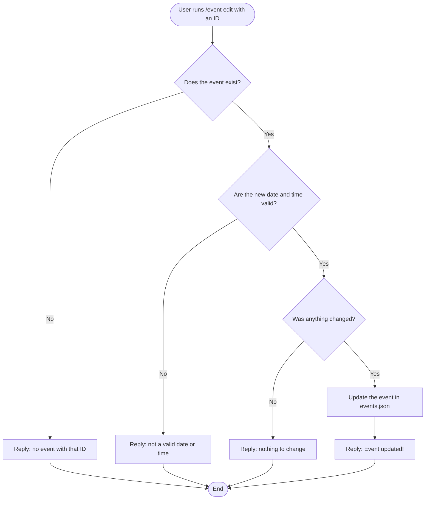
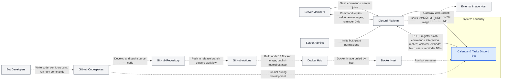

Architecture.md file
## Activity Diagrams: Calendar Events (Hakan)

These activity diagrams show the step-by-step flow when a user runs `/event add` and `/event edit`, including each decision the bot makes.

### Activity Diagram 1: `/event add`

### Activity Diagram 2: `/event edit`

### Notes
- Diamonds are yes/no decisions. Every "No" path sends an error that only the user can see.
- Both commands check the input **before** saving, so bad data never gets into `events.json`.
- Known limit: anyone can edit any event right now. A future fix is to only let the creator or a moderator edit it.

### System Context Diagram Description

The System Context Diagram illustrates how the **Calendar & Tasks Discord Bot** interacts with external users, services, and development infrastructure. The bot is represented as a single system within its boundary, focusing on external interactions rather than internal implementation.

At runtime, **Discord serves as the primary communication interface** between server members and the bot. Users submit slash commands through Discord, which forwards interactions to the bot using Gateway events. The bot communicates through Discord's REST API to display calendars, manage events and tasks, send automated reminders, and welcome new members. Welcome messages include an image URL that Discord clients retrieve from an external image host.

The diagram also illustrates the **development and deployment process**, including GitHub Codespaces, GitHub Actions, Docker Hub, and the Docker host. **Solid arrows** represent runtime interactions, while **dotted arrows** represent development, deployment, or indirect interactions.

Local JSON files store application data within the system boundary, so no external database is shown.

## System Context Diagram

**Legend:** Solid arrows represent runtime interactions. Dotted arrows represent build-time, deployment, or indirect interactions. Arrowheads indicate the direction of data or control flow.

### System Context Diagram Description

The System Context Diagram illustrates how the **Calendar & Tasks Discord Bot** interacts with external users, services, and development infrastructure. The bot is represented as a single system within its boundary, focusing on external interactions rather than internal implementation.

At runtime, **Discord serves as the primary communication interface** between server members and the bot. Users submit slash commands through Discord, which forwards interactions to the bot using Gateway events. The bot communicates through Discord's REST API to display calendars, manage events and tasks, send automated reminders, and welcome new members. Welcome messages include an image URL that Discord clients retrieve from an external image host.

The diagram also illustrates the **development and deployment process**, including GitHub Codespaces, GitHub Actions, Docker Hub, and the Docker host. **Solid arrows** represent runtime interactions, while **dotted arrows** represent development, deployment, or indirect interactions.

Local JSON files store application data within the system boundary, so no external database is shown.

