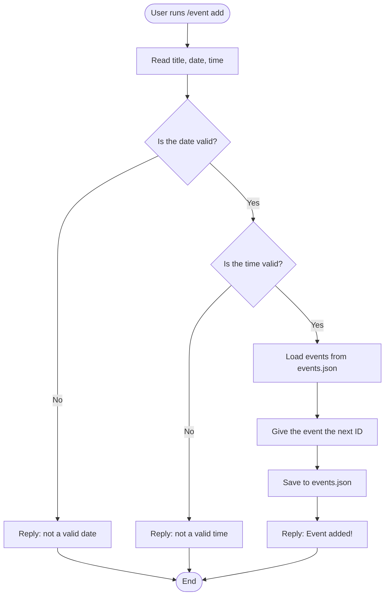

Architecture.md file
## Activity Diagrams: Calendar Events (Hakan)

These activity diagrams show the step-by-step flow when a user runs `/event add` and `/event edit`, including each decision the bot makes.

### Activity Diagram 1: `/event add`

### Activity Diagram 2: `/event edit`

### Notes
- Diamonds are yes/no decisions. Every "No" path sends an error that only the user can see.
- Both commands check the input **before** saving, so bad data never gets into `events.json`.
- Known limit: anyone can edit any event right now. A future fix is to only let the creator or a moderator edit it.