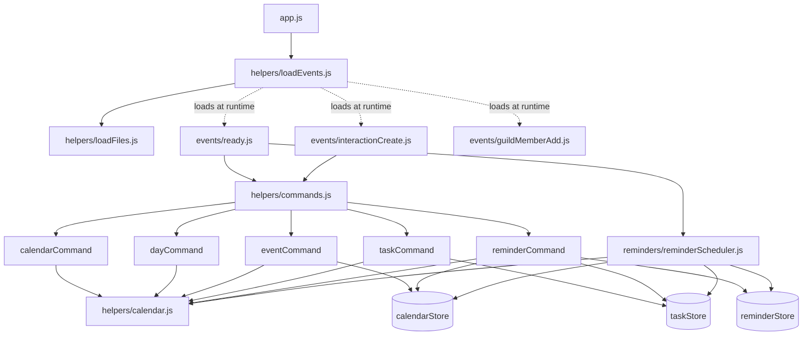

# Code Analysis Report

ECRA Group 5 · CSS 360 · Bot Project Task 5

> Each team member adds their section below. Analysis is based on `main` at commit `6cd147f`.

---

## Cohesion and Coupling (Zad)

### How we measured it

**Coupling** was measured from the module import graph of `src/`. For every file we counted:

- **Ca (afferent coupling / fan-in):** how many of our modules depend on this one.
- **Ce (efferent coupling / fan-out):** how many of our modules this one depends on.
- **I (instability) = Ce / (Ca + Ce):** 0 means stable (many depend on it, it depends on nothing), 1 means unstable (it depends on others, nothing depends on it).

The counts come from a script that parses every `import`/`require` in `src/`. We also added the three event files that `loadEvents.js` loads dynamically, since a plain import scan misses them. External libraries (`discord.js`, `luxon`, `fs`) are listed separately, not counted in Ca/Ce. We then read each dependency to classify *what kind* of coupling it is (data, stamp, control, common/global, external), using the standard coupling scale from best to worst.

**Cohesion** was assessed per module by reading what each exported function does and asking whether the functions share one purpose. We used the standard cohesion scale: functional (best) → sequential → communicational → logical → coincidental (worst). Class-based metrics such as LCOM don't apply, because the bot is written as modules of functions, not classes.

### Dependency graph



### Coupling metrics

| Module | Ca | Ce | I | External libraries |
|---|---|---|---|---|
| `helpers/calendar.js` | 6 | 0 | 0.00 | luxon |
| `helpers/calendarStore.js` | 3 | 0 | 0.00 | fs, path |
| `helpers/taskStore.js` | 3 | 0 | 0.00 | fs, path |
| `reminders/reminderStore.js` | 2 | 0 | 0.00 | fs, path |
| `helpers/commands.js` | 2 | 5 | 0.71 | — |
| `helpers/eventCommand.js` | 1 | 2 | 0.67 | discord.js |
| `helpers/taskCommand.js` | 1 | 2 | 0.67 | discord.js |
| `helpers/reminderCommand.js` | 1 | **4** | **0.80** | discord.js |
| `reminders/reminderScheduler.js` | 1 | **4** | **0.80** | (Discord client passed in) |
| `events/ready.js` | 1 | 2 | 0.67 | — |
| `events/interactionCreate.js` | 1 | 1 | 0.50 | — |
| `events/guildMemberAdd.js` | 1 | 0 | 0.00 | discord.js |
| `helpers/calendarCommand.js`, `dayCommand.js` | 1 | 1 | 0.50 | discord.js |
| `helpers/loadEvents.js` | 0 | 4 | 1.00 | ascii-table, path |
| `app.js` | 0 | 1 | 1.00 | discord.js |

### What the numbers say

**The overall structure is healthy.**

- **There are no circular dependencies.**
- **Dependencies point toward stability.** The modules that many others rely on (`calendar.js` and the three stores, I = 0) depend on no other module of ours. The modules that change most often, the commands, sit on top with I ≥ 0.5. This follows the Stable Dependencies Principle: a change to one command can't break another command.
- **The command dispatch is well decoupled.** `interactionCreate.js` only knows about the `commands` list. A new command is added by writing one file and adding it to that list, with no change to the event handler.

**The reminder feature is the most tightly coupled part of the bot.**

`reminderCommand.js` and `reminderScheduler.js` each have the highest fan-out (Ce = 4). Each reaches into *both* other features' stores, so a reminder depends on how events and tasks are stored.

- **Stamp coupling.** Both files read the internal fields of task and event records (`id`, `title`, `done`) directly, with no shared interface. If the task schema changes, for example renaming `done` to `status`, reminders break silently, and neither file is mentioned in the task code.
- **Control coupling.** The string `type` (`"task"` or `"event"`) decides which store to search. The same `type === "task" ? getTasks() : getCalendarEvents()` branch appears in both files. A third reminder type would mean editing both.

**The JSON data files create common (global) coupling.**

- **A shared folder.** All three stores write to `process.cwd()/data`, which every module shares implicitly. We hit this directly while writing the smoke test: the test has to change its working directory *before* loading any bot code, or it would overwrite the real data.
- **IDs with no integrity checks.** Reminders reference task and event IDs stored in *other* files, and nothing keeps those references valid. Each store assigns new IDs as `max(id) + 1`, so **deleting the newest event lets its ID be reused**. We confirmed this with a script: add events 1 and 2, delete 2, add another, and the new event gets ID 2. A reminder created for the deleted event would then fire for the unrelated new one, because the scheduler only checks that *some* event with that ID exists.

**External coupling to Discord limits testability.**

- **Commands.** Every command reads its input straight from the discord.js `interaction` object and replies through it. Validation and business logic are mixed into those handlers.
- **Scheduler.** It needs a live Discord client to fetch users and send DMs.
- **The result.** There is no way to test "is this a valid task?" without building a fake Discord interaction. The smoke test does exactly that.

### Cohesion by module

| Module | Cohesion | Why |
|---|---|---|
| `calendarStore.js`, `taskStore.js`, `reminderStore.js` | Functional (high) | Each owns exactly one data file and its CRUD operations. |
| `calendar.js` | Mostly functional | All functions are Pacific-time date logic, but it also renders Discord text (`monthToText`, `dayToText`), which mixes presentation into a utility library. |
| `reminderScheduler.js` | Sequential | It looks up due reminders, then checks their items, then sends DMs, then saves. These are one pipeline, but lookup, delivery, and persistence could be split. |
| `eventCommand.js` (194 lines), `taskCommand.js` (244 lines), `reminderCommand.js` | Communicational (moderate) | Each file combines five jobs on the same input: the slash-command schema, input parsing, validation, saving, and reply formatting. |
| `helpers/` folder as a whole | Logical (low) | It holds four unrelated kinds of file: command handlers, data stores, the calendar library, and startup loaders. Reminders are also split inconsistently: `reminderCommand.js` is in `helpers/`, while its store is in `reminders/`. |
| `guildMemberAdd.js` | Contains dead code | `getWelcomeMessage` is never called (also flagged by ESLint in Task 4). |

### Duplication found while measuring

Low cohesion in the command files leads to copy-pasted logic:

- **Date/time validation:** the same "is this a valid date / valid time" check and error reply is repeated **8 times across 3 files**, with three different wordings. This is why `/reminder` errors read differently from `/task` and `/event` errors.
- **Date-plus-time combining:** "date string + `HH:MM` → Pacific datetime" is written once in `taskCommand.js` (`dueDateTime`) and again inline in `reminderCommand.js`. It belongs in `calendar.js`.
- **Store logic:** the three stores are near-identical: read JSON, write JSON, `max(id) + 1`. One generic `JsonStore` would remove the duplication *and* fix the ID-reuse bug in one place.
- **Timezone label:** while comparing these copies we found that `/reminder add` hardcodes the label **"PDT"** in its reply. Every reminder created between November and March therefore shows the wrong timezone. `calendar.js` already gets this right with Luxon's `ZZZZ` format.

### Recommendations

1. **Extract the validation helpers** (`parseDate`, `parseTime`, `toDateTime`) into `calendar.js`, and use them in all three commands.
2. **Introduce a shared store module.** IDs should never be reused, for example a stored counter instead of `max(id) + 1`, and deleting an item should delete or flag its reminders.
3. **Give reminders a lookup function per type**, for example `findItem(type, id)` in one place, instead of reading task and event fields directly in two files.
4. **Separate validation and business logic from the Discord interaction**, so features can be unit tested without fakes.
5. **Reorganize the folders by feature or by layer**, for example `commands/`, `stores/`, and `lib/`, instead of putting most files in `helpers/`.

---

## Smoke Test (Zad)

### What we built

`tests/smoke.spec.js` is a Mocha + Chai test that runs **every major feature of the bot in one pass**, without connecting to Discord. Run it with:

```bash
npm test
```

Fake interaction objects stand in for real slash commands. They are sent through the **real `interactionCreate` handler**, so each check covers command routing, input validation, saving to JSON, and the reply text together. A fake Discord client stands in for the bot's connection. It records which commands get registered and which DMs get sent.

| # | Check | Feature |
|---|---|---|
| 1 | All 5 slash commands build valid Discord definitions | Startup |
| 2 | `/calendar` shows the current month and a chosen month | Calendar |
| 3 | `/day` shows hour slots; a bad date gets an error reply, not a crash | Calendar, error handling |
| 4 | `/event add` saves to `events.json`; an impossible date (Feb 30) is rejected | Events |
| 5 | `/event edit` changes only the given field | Events |
| 6 | `/task add` saves a task with an assignee mention | Tasks |
| 7 | `/task edit` adds a second assignee | Tasks |
| 8 | `/task complete` marks a task done; `undo` reopens it | Tasks |
| 9 | `/reminder add` creates a reminder for an existing task | Reminders |
| 10 | `/reminder add` refuses an item that doesn't exist | Reminders |
| 11 | `/event delete` removes the event; deleting again reports it's gone | Events |
| 12 | On `ready`: commands register with the server, and a due reminder is sent as a DM and marked `sent` | Startup, reminder scheduler |
| 13 | A new member gets a welcome message with an embed in the configured channel | Welcome |

**Result: 13 passing.** All core features work end to end. The test runs in a temporary folder and deletes it afterward, so the real `data/` folder is never touched. Test dates are always one year in the future, so the test won't go stale.

### What writing the smoke test revealed

- **Hidden global state.** Every store computes its file path from the working directory *when the module is first loaded*. The test therefore has to switch folders before loading any bot code. This is the common-coupling problem described in the section above.
- **The test setup was broken on newer Node.** The `npm test` script existed, but there was no `tests/` folder. On Node 22, which our Codespace uses, a test file written with `import` syntax is loaded as an ES module and skips `esbuild-runner`. The test only worked once it was written with `require`. The Dockerfile still uses Node 18, so dev and production run different Node versions.
- **Testing needed heavy fakes.** Since every command depends directly on the discord.js `interaction` object, checking one validation rule requires faking Discord. This supports recommendation 4 above.

### What the smoke test does *not* cover

- **Real Discord behavior:** permissions, rate limits, and gateway disconnects.
- **Two commands running at once.** Both read and rewrite the same JSON file, so one save can overwrite the other.
- **The ID-reuse and "PDT" bugs.** These were found by reading the code during the coupling analysis. Each should get its own unit test once fixed.
- **The scheduler's 30-second repeat.** Only its first, immediate check is exercised.

## Technical Debt and Code Smells (Hakan)

**How I did it:** I read all the code in `src/`, looked for TODO notes, and used my ESLint results from Lab 1.

**What I found:**

1. **Copied code:** the 3 store files (calendar, task, reminder) have the same code. One fix has to be done 3 times.
2. **Data can get erased:** if a JSON file breaks, the bot treats it as empty, and the next save wipes everything.
3. **Unfinished permission checks:** 5 TODO notes were never finished, so anyone can edit or delete anyone's stuff.
4. **Usernames instead of IDs:** we save usernames instead of user IDs, but people can change their usernames.
5. **Unused code:** `getWelcomeMessage` is never used (ESLint found it).
6. **Big files:** `taskCommand.js` (244 lines) and `eventCommand.js` (194 lines) do too many jobs.
7. **No tests:** there is a test script but no tests.

**Summary:** The biggest problems are #2 (losing data) and #3 (no permission checks). The easiest fixes are #1 (share the code) and #5 (delete unused code). Zad's coupling analysis above found some of the same problems (#1 and #5), which shows they're real.

## Threat Model (Hakan)

**How I did it:** I used the 4 threat model questions and STRIDE from class.

**1. What are we working on?**
Our Discord bot (`/calendar`, `/day`, `/event`, `/task`, `/reminder`). It saves data in JSON files, uses a secret token, and the code is public on GitHub.

**2. What can go wrong? (STRIDE)**

- **Spoofing:** if the token leaks, someone can pretend to be our bot. (This happened once and we reset it.)
- **Tampering:** anyone can edit or delete other people's events and tasks.
- **Repudiation:** nothing records who changed or deleted something.
- **Info disclosure:** every server uses the same data files.
- **Denial of service:** people can spam `/event add`, and a broken file makes all data look gone.
- **Elevation of privilege:** normal members can delete anything, like an admin. A title with `@everyone` could ping the whole server.

**3. What will we do?**
Only let creators or mods edit/delete, save a server ID with each item, block `@everyone` pings, add spam limits and backups, record changes, and keep the token secret.

**4. Did we do enough?**
Not yet. These fixes are now user stories on our board (#34 and #35), and we should check again each sprint.

## Cyclomatic Complexity (Ilakshi)

### How we measured it

Cyclomatic complexity (CC) counts the independent paths through a function: 1, plus 1 for each branch (`if`, `else if`, loops, `case`, `catch`, `&&`, `||`, `??`, `?.`, ternaries). Higher numbers mean more paths to test and more room for bugs.

We measured every function in `src/` using ESLint's built-in `complexity` rule, with the limit set to 0 so every function is reported:

```bash
npx eslint src --rule '{"complexity": ["warn", 0]}'
```

We rated the results with the standard McCabe thresholds: **1–10** simple, **11–20** moderate, **21–50** complex, **50+** untestable.

### Summary

| Metric | Value |
|---|---|
| Functions analyzed | 115 |
| Average CC (all functions) | 2.1 |
| Average CC (named functions only) | 3.2 |
| Highest CC | 21 (`handleEdit` in `taskCommand.js`) |
| Functions above 10 | 2 |

| CC range | Rating | Functions |
|---|---|---|
| 1 | Trivial | 77 |
| 2–5 | Simple | 32 |
| 6–10 | Simple | 4 |
| 11–20 | Moderate | 1 |
| 21+ | Complex | 1 |

Most of the CC = 1 functions are arrow functions used to build slash command options. They lower the overall average, so we also report the average for named functions only.

### Most complex functions

| CC | Function | File |
|---|---|---|
| **21** | `handleEdit` | `src/helpers/taskCommand.js:145` |
| **13** | reminder check callback (inside `startReminderScheduler`) | `src/reminders/reminderScheduler.js:13` |
| 9 | `execute` | `src/helpers/reminderCommand.js:46` |
| 9 | `handleAdd` | `src/helpers/taskCommand.js:79` |
| 8 | `handleEdit` | `src/helpers/eventCommand.js:108` |
| 6 | `execute` | `src/events/interactionCreate.js:7` |

### By file

| File | Functions | Total CC | Max CC |
|---|---|---|---|
| `helpers/taskCommand.js` | 24 | 59 | 21 |
| `helpers/calendar.js` | 16 | 40 | 5 |
| `helpers/eventCommand.js` | 22 | 39 | 8 |
| `helpers/calendarStore.js` | 10 | 18 | 4 |
| `reminders/reminderScheduler.js` | 3 | 16 | 13 |
| `helpers/taskStore.js` | 9 | 16 | 4 |
| `helpers/reminderCommand.js` | 7 | 15 | 9 |
| `events/interactionCreate.js` | 2 | 7 | 6 |
| `helpers/dayCommand.js` | 4 | 7 | 4 |
| `helpers/loadEvents.js` | 2 | 6 | 5 |
| `reminders/reminderStore.js` | 4 | 6 | 3 |
| `events/guildMemberAdd.js` | 5 | 5 | 1 |
| `helpers/calendarCommand.js` | 3 | 5 | 3 |
| `events/ready.js` | 2 | 3 | 2 |
| `helpers/loadFiles.js` | 2 | 2 | 1 |

### Findings

- **Overall, the codebase has low complexity.** 113 of 115 functions (98%) are in the simple range (CC ≤ 10). Keeping each command in its own file, with separate store files for data, keeps most functions small.
- **`taskCommand.js` → `handleEdit` (CC 21) is the most complex function.** Every field a user can edit (title, due date, time, assignees) adds its own validation branches, so they all pile up in one function.
- **The reminder scheduler callback (CC 13) is the second most complex function.** It loads data, skips invalid or already-sent reminders, handles deleted or completed items, sends the DM, and catches errors, all inside one loop.
- **Command handlers are generally higher than helpers.** Most of their branches are input validation with early returns, such as invalid dates, past times, or missing IDs.

### Recommendations

1. **Split up `handleEdit`.** Move the date/time validation and assignee changes into separate helper functions. This should reduce the CC and bring it under 10, and each helper can be tested on its own.
2. **Extract a `processReminder(reminder, tasks, events)` function** from the scheduler loop. The loop then just calls it for each reminder, and the skip/send logic can be tested without a timer.
3. **Share validation between commands.** `taskCommand.js`, `eventCommand.js`, and `reminderCommand.js` all validate dates and times. A shared helper would reduce both complexity and duplicated code.
4. **Add a complexity limit to the ESLint config** (for example, `complexity: ["warn", 10]`) so new code that gets too complex is flagged automatically.

## Hosting & Continuous Deployment (Ilakshi)

### How we did it

During development, we ran the bot in GitHub Codespaces with `npm start`. That doesn't work for continuous service:

- Codespaces shuts down after a period of inactivity, which takes the bot offline.
- Each teammate's Codespace had its own `data/` folder, so tasks, events and reminders weren't shared, and were lost when a Codespace was rebuilt.
- Running the bot solely on GitHub Actions would mean chaining jobs that stop after 6 hours, with downtime between runs and no files kept between them. GitHub's terms also don't allow using Actions to host a service.

We moved the bot to a dedicated server on **AWS Lightsail** so it stays online 24/7 with saved storage.

### Setup
|  |  |
|---|---|
| Service | AWS Lightsail |
| Region | Ohio (`us-east-2`) |
| OS | Ubuntu 24.04 LTS |
| Plan | 512 MB RAM, 2 vCPUs, 20 GB SSD (1 GB swap added) |
| Networking | Static IP; firewall allows SSH (port 22) only |

The bot only makes outgoing connections to Discord, so no incoming ports are open apart from SSH for administration. The bot runs as a **Docker container** built from the repo's `Dockerfile`.

Previously, each team member ran their own copy of the bot from their Codespace. We now have one bot that runs on the `main` branch, and only use our individual bots to test new features.

### Updating the bot

The server has an update script, `~/update-bot.sh`, that pulls the latest code from `main`, rebuilds the image, replaces the running container, and cleans up old images. The bot is offline for only a few seconds during an update, and the data volume is untouched.

### Testing

To ensure everything worked as expected, we tested that: 
- Slash commands (`/calendar`, `/task add`, `/task edit`) respond from the hosted bot.
- After a full server reboot, the bot came back online on its own, and a task created before the reboot could still be edited. This confirms that both the restart policy and the persistent storage work.


### Next steps

- **Continuous deployment:** a GitHub Actions workflow will SSH into the server and run `~/update-bot.sh` on every merge to `main`, so updates no longer need to be done by hand.
- **Data across servers:** all Discord servers the bot is in share the same data files. Supporting multiple servers properly would mean storing a server ID with each item.
---

## Unit Tests (Sarah)

### What I tested

I wrote five unit tests for `taskStore.js` using Mocha and Chai. My tests focus on the individual functions responsible for saving, retrieving, and updating task data.

The tests cover:

1. **Looking up a nonexistent task:** Verified that `getTaskById()` returns `undefined` when a task ID cannot be found.
2. **Updating a nonexistent task:** Verified that `updateTask()` returns `null` and does not accidentally modify another task.
3. **Generating task IDs:** Added multiple tasks and checked that each receives a unique ID.
4. **Saving and loading tasks:** Verified that tasks saved to the JSON file can be loaded with their original information.
5. **Handling invalid JSON:** Verified that `getTasks()` returns an empty array when the tasks file contains invalid JSON instead of crashing.

### Results and observations

All five unit tests passed.

One limitation I noticed while reviewing the code is that `getTasks()` catches errors when the JSON file cannot be parsed and returns an empty array. This prevents the bot from crashing, but it could also hide corrupted task data. The bot would behave as if there are no saved tasks, even if task information was previously stored in the file. Although this is unlikely during normal use, the code does not warn the user or attempt to recover the data if it happens.

## Proposed Feature (Sarah)

### Idea: Add task priorities

I think the bot would be more useful if users could assign priorities to tasks. When a server has several tasks, it can be difficult to tell which ones need attention first. Adding priority levels would help users organize their responsibilities.

### Proposed scope

- Allow users to assign a priority of High, Medium, or Low when creating or editing a task.
- Display the priority when users view a task.
- Allow users to change a task's priority.
- Use a default priority when one is not specified.

This feature would help server members identify important tasks and decide what to work on first. It would also make the bot more useful for managing multiple responsibilities.

## Fuzzing (Cam)
What I built

tests/fuzz-calendar.js is a fuzzer written with fast-check. A unit test checks a few inputs I picked by hand. A fuzzer does the opposite: I write a rule that should always be true, and fast-check throws thousands of random inputs at the code to find one that breaks the rule. When it finds one, it shrinks it down to the smallest input that still fails. Run it with:

bash
npm install --save-dev fast-check   # once
npm run fuzz

It has to run through esbuild-runner (the same way npm test does), because the bot's code uses import. Plain node tests/fuzz-calendar.js does not work.

What it fuzzes: my part of the bot, calendar.js, plus the /event add command and calendarStore.js, which depend on it. Like the smoke test, it sends fake interactions through the real interactionCreate handler and saves to a temporary folder, so the real data/ folder is never touched.

The inputs: random text mixed with a list of values chosen to cause trouble: empty and whitespace-only text, emoji, @everyone and @here, Markdown like ```, impossible dates (2026-02-30, 0000-00-00), daylight saving dates, bad times (24:00, 9:5), and text longer than 2,000 characters. Dates cover every day from 2020 to 2035.

The rules and results

Tested on bot-task-5 at commit 7cd162c. Each rule gets between 500 and 50,000 random inputs. The whole run takes about 4 seconds.

#	Rule	Result
1	isValidDate never crashes, and any date it accepts reads back the same from toDate	Held
2	normalizeTime never crashes and only returns a real HH:MM time or null	Held
3	toDateTime(date, hour) gives back the hour that was asked for	Broken
4	getHours gives 24 slots, each one hour after the last	Broken
5	dayToText shows exactly the hours from from to to	Held
6	getMonthGrid has 7-day weeks and every day of the month once, in order	Held
7	/event add never crashes, replies exactly once, and only saves valid dates and times	Held
8	/event add never saves an event with a blank title	Broken
9	/event add replies fit in Discord's 2,000-character message limit	Broken
10	/event add replies can't ping @everyone or @here	Broken
11	Event IDs are never reused, even after deleting events	Broken

6 of 11 rules were broken. The fuzzer exits with an error code when any rule breaks, so it is kept out of npm test on purpose. Otherwise the whole team's tests would fail until these bugs are fixed.

What it found

1. Daylight saving time breaks the hour slots (rules 3 and 4, in my own code).

Spring forward. On the day the clocks jump ahead, 2 AM does not exist in Pacific time. toDateTime("2020-03-08", 2) returns 3 AM instead of an error. In getHours, the "2 AM" slot and the "3 AM" slot both start at 3 AM, so an event at 3 AM would match two slots.
Fall back. On the day the clocks go back, 1 AM happens twice. getHours("2022-11-06") still returns 24 slots for a 25-hour day, and the "2 AM" slot starts two hours after the "1 AM" slot. The second 1 AM has no slot.
Why I missed it. This only happens on 2 days a year, so my hand-written tests never hit it. The fuzzer found both days because it tries every date.

2. A title of only spaces is saved as a blank title (rule 8). Discord's "required" check accepts a title like "   ". The command trims it and saves an event with an empty title. Smallest failing input: {"title":"","date":"2028-02-29","time":"9:05"}.

3. Long input makes a reply Discord would reject (rule 9). A string option can be up to 6,000 characters, but a message can only be 2,000. There are two ways to trigger it:

A long invalid date is repeated back inside the error message.
A long description is saved, and then the "Event added!" confirmation is too long to send. The event exists, but the user would see a failure.

4. The bot repeats @everyone and @here back to the channel (rule 10). Any text field is echoed in the reply, including an invalid date in the error message ({"date":"@everyone"}). If the bot has the Mention Everyone permission, this pings the whole server. Hakan's threat model predicted this under elevation of privilege. The fuzzer confirms it and shows it is not limited to titles.

5. Event IDs are reused after a delete (rule 11). Smallest failing sequence: add, delete ID 1, add. The new event gets ID 1 again. Zad found this by reading the code during the coupling analysis. The fuzzer found it on its own, with no hint about where to look.

What held up

Date and time validation is solid. Across 10,000 random inputs, isValidDate and normalizeTime never crashed and never accepted a fake date or time. /event add never crashed and never saved an invalid date or time. The month grid was correct for every month from 1970 to 2100.

Recommendations
Handle daylight saving in calendar.js. Reject or clearly label the missing 2 AM hour, and build getHours by adding one hour at a time so the 23-hour and 25-hour days come out right.
Reject blank titles after trimming, with the same kind of error reply as an invalid date.
Limit the length of user text in replies, or set setMaxLength on the string options.
Turn off mentions in replies with allowedMentions: { parse: [] }, so repeated text can never ping anyone.
Stop reusing IDs, as already recommended in the coupling section.
What the fuzzer does not cover
Other commands. /task, /reminder, /event edit, and /event delete are not fuzzed yet. They share the same validation, so they likely share bugs 3 and 4.
Real Discord. The interactions are fakes. Bugs 3 and 4 are based on Discord's documented limits and mention rules, not on a live server.
Out-of-range numbers. Discord enforces the 0-23 and 1-12 limits on integer options before the bot sees them, so I did not fuzz those through the commands.

## Unit Tests (Cam)

I wrote five unit tests for calendar.js in tests/calendar.spec.js, using Mocha and Chai like the rest of the tests. Run them with npm test.

Valid dates: isValidDate accepts real YYYY-MM-DD dates, including Feb 29 in a leap year. It rejects Feb 30, Feb 29 in a non-leap year, and other formats like 2026-11 and 11/05/2026.
Time formatting: normalizeTime turns 9:05 into 09:05 and returns null for 24:00, 12:60, 3pm, and 9:5.
Date plus hour: toDateTime builds the right Pacific time ("Thu, Nov 5, 2026 at 3 PM PST") and throws for hours outside 0-23 and for bad dates.
Hour labels: hourLabel turns 0, 9, 12, and 15 into "12 AM", "9 AM", "12 PM", and "3 PM".
Month grid: getMonthGrid lays out February 2026 as exactly four full weeks, and throws for month 13.

Result: all 5 pass, which brings npm test to 23 passing. These tests check the normal cases and the obvious bad inputs. None of them caught the daylight saving bug, which is a good example of why the fuzzer was worth adding.