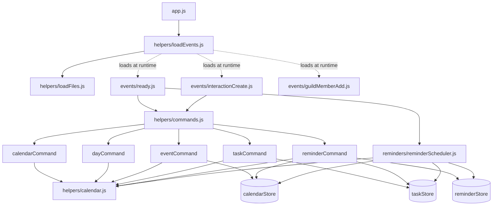

# Code Analysis Report

ECRA Group 5 · CSS 360 · Bot Project Task 5

> Each team member adds their section below. Analysis is based on `main` at commit `6cd147f`.

---

## Cohesion and Coupling (Zad)

### How we measured it

**Coupling** was measured from the module import graph of `src/`. For every file we counted:

- **Ca (afferent coupling / fan-in):** how many of our modules depend on this one.
- **Ce (efferent coupling / fan-out):** how many of our modules this one depends on.
- **I (instability) = Ce / (Ca + Ce):** 0 means stable (many depend on it, it depends on nothing), 1 means unstable (it depends on others, nothing depends on it).

The counts come from a script that parses every `import`/`require` in `src/`. We also added the three event files that `loadEvents.js` loads dynamically, since a plain import scan misses them. External libraries (`discord.js`, `luxon`, `fs`) are listed separately, not counted in Ca/Ce. We then read each dependency to classify *what kind* of coupling it is (data, stamp, control, common/global, external), using the standard coupling scale from best to worst.

**Cohesion** was assessed per module by reading what each exported function does and asking whether the functions share one purpose. We used the standard cohesion scale: functional (best) → sequential → communicational → logical → coincidental (worst). Class-based metrics such as LCOM don't apply, because the bot is written as modules of functions, not classes.

### Dependency graph



### Coupling metrics

| Module | Ca | Ce | I | External libraries |
|---|---|---|---|---|
| `helpers/calendar.js` | 6 | 0 | 0.00 | luxon |
| `helpers/calendarStore.js` | 3 | 0 | 0.00 | fs, path |
| `helpers/taskStore.js` | 3 | 0 | 0.00 | fs, path |
| `reminders/reminderStore.js` | 2 | 0 | 0.00 | fs, path |
| `helpers/commands.js` | 2 | 5 | 0.71 | — |
| `helpers/eventCommand.js` | 1 | 2 | 0.67 | discord.js |
| `helpers/taskCommand.js` | 1 | 2 | 0.67 | discord.js |
| `helpers/reminderCommand.js` | 1 | **4** | **0.80** | discord.js |
| `reminders/reminderScheduler.js` | 1 | **4** | **0.80** | (Discord client passed in) |
| `events/ready.js` | 1 | 2 | 0.67 | — |
| `events/interactionCreate.js` | 1 | 1 | 0.50 | — |
| `events/guildMemberAdd.js` | 1 | 0 | 0.00 | discord.js |
| `helpers/calendarCommand.js`, `dayCommand.js` | 1 | 1 | 0.50 | discord.js |
| `helpers/loadEvents.js` | 0 | 4 | 1.00 | ascii-table, path |
| `app.js` | 0 | 1 | 1.00 | discord.js |

### What the numbers say

**The overall structure is healthy.**

- **There are no circular dependencies.**
- **Dependencies point toward stability.** The modules that many others rely on (`calendar.js` and the three stores, I = 0) depend on no other module of ours. The modules that change most often, the commands, sit on top with I ≥ 0.5. This follows the Stable Dependencies Principle: a change to one command can't break another command.
- **The command dispatch is well decoupled.** `interactionCreate.js` only knows about the `commands` list. A new command is added by writing one file and adding it to that list, with no change to the event handler.

**The reminder feature is the most tightly coupled part of the bot.**

`reminderCommand.js` and `reminderScheduler.js` each have the highest fan-out (Ce = 4). Each reaches into *both* other features' stores, so a reminder depends on how events and tasks are stored.

- **Stamp coupling.** Both files read the internal fields of task and event records (`id`, `title`, `done`) directly, with no shared interface. If the task schema changes, for example renaming `done` to `status`, reminders break silently, and neither file is mentioned in the task code.
- **Control coupling.** The string `type` (`"task"` or `"event"`) decides which store to search. The same `type === "task" ? getTasks() : getCalendarEvents()` branch appears in both files. A third reminder type would mean editing both.

**The JSON data files create common (global) coupling.**

- **A shared folder.** All three stores write to `process.cwd()/data`, which every module shares implicitly. We hit this directly while writing the smoke test: the test has to change its working directory *before* loading any bot code, or it would overwrite the real data.
- **IDs with no integrity checks.** Reminders reference task and event IDs stored in *other* files, and nothing keeps those references valid. Each store assigns new IDs as `max(id) + 1`, so **deleting the newest event lets its ID be reused**. We confirmed this with a script: add events 1 and 2, delete 2, add another, and the new event gets ID 2. A reminder created for the deleted event would then fire for the unrelated new one, because the scheduler only checks that *some* event with that ID exists.

**External coupling to Discord limits testability.**

- **Commands.** Every command reads its input straight from the discord.js `interaction` object and replies through it. Validation and business logic are mixed into those handlers.
- **Scheduler.** It needs a live Discord client to fetch users and send DMs.
- **The result.** There is no way to test "is this a valid task?" without building a fake Discord interaction. The smoke test does exactly that.

### Cohesion by module

| Module | Cohesion | Why |
|---|---|---|
| `calendarStore.js`, `taskStore.js`, `reminderStore.js` | Functional (high) | Each owns exactly one data file and its CRUD operations. |
| `calendar.js` | Mostly functional | All functions are Pacific-time date logic, but it also renders Discord text (`monthToText`, `dayToText`), which mixes presentation into a utility library. |
| `reminderScheduler.js` | Sequential | It looks up due reminders, then checks their items, then sends DMs, then saves. These are one pipeline, but lookup, delivery, and persistence could be split. |
| `eventCommand.js` (194 lines), `taskCommand.js` (244 lines), `reminderCommand.js` | Communicational (moderate) | Each file combines five jobs on the same input: the slash-command schema, input parsing, validation, saving, and reply formatting. |
| `helpers/` folder as a whole | Logical (low) | It holds four unrelated kinds of file: command handlers, data stores, the calendar library, and startup loaders. Reminders are also split inconsistently: `reminderCommand.js` is in `helpers/`, while its store is in `reminders/`. |
| `guildMemberAdd.js` | Contains dead code | `getWelcomeMessage` is never called (also flagged by ESLint in Task 4). |

### Duplication found while measuring

Low cohesion in the command files leads to copy-pasted logic:

- **Date/time validation:** the same "is this a valid date / valid time" check and error reply is repeated **8 times across 3 files**, with three different wordings. This is why `/reminder` errors read differently from `/task` and `/event` errors.
- **Date-plus-time combining:** "date string + `HH:MM` → Pacific datetime" is written once in `taskCommand.js` (`dueDateTime`) and again inline in `reminderCommand.js`. It belongs in `calendar.js`.
- **Store logic:** the three stores are near-identical: read JSON, write JSON, `max(id) + 1`. One generic `JsonStore` would remove the duplication *and* fix the ID-reuse bug in one place.
- **Timezone label:** while comparing these copies we found that `/reminder add` hardcodes the label **"PDT"** in its reply. Every reminder created between November and March therefore shows the wrong timezone. `calendar.js` already gets this right with Luxon's `ZZZZ` format.

### Recommendations

1. **Extract the validation helpers** (`parseDate`, `parseTime`, `toDateTime`) into `calendar.js`, and use them in all three commands.
2. **Introduce a shared store module.** IDs should never be reused, for example a stored counter instead of `max(id) + 1`, and deleting an item should delete or flag its reminders.
3. **Give reminders a lookup function per type**, for example `findItem(type, id)` in one place, instead of reading task and event fields directly in two files.
4. **Separate validation and business logic from the Discord interaction**, so features can be unit tested without fakes.
5. **Reorganize the folders by feature or by layer**, for example `commands/`, `stores/`, and `lib/`, instead of putting most files in `helpers/`.

---

## Smoke Test (Zad)

### What we built

`tests/smoke.spec.js` is a Mocha + Chai test that runs **every major feature of the bot in one pass**, without connecting to Discord. Run it with:

```bash
npm test
```

Fake interaction objects stand in for real slash commands. They are sent through the **real `interactionCreate` handler**, so each check covers command routing, input validation, saving to JSON, and the reply text together. A fake Discord client stands in for the bot's connection. It records which commands get registered and which DMs get sent.

| # | Check | Feature |
|---|---|---|
| 1 | All 5 slash commands build valid Discord definitions | Startup |
| 2 | `/calendar` shows the current month and a chosen month | Calendar |
| 3 | `/day` shows hour slots; a bad date gets an error reply, not a crash | Calendar, error handling |
| 4 | `/event add` saves to `events.json`; an impossible date (Feb 30) is rejected | Events |
| 5 | `/event edit` changes only the given field | Events |
| 6 | `/task add` saves a task with an assignee mention | Tasks |
| 7 | `/task edit` adds a second assignee | Tasks |
| 8 | `/task complete` marks a task done; `undo` reopens it | Tasks |
| 9 | `/reminder add` creates a reminder for an existing task | Reminders |
| 10 | `/reminder add` refuses an item that doesn't exist | Reminders |
| 11 | `/event delete` removes the event; deleting again reports it's gone | Events |
| 12 | On `ready`: commands register with the server, and a due reminder is sent as a DM and marked `sent` | Startup, reminder scheduler |
| 13 | A new member gets a welcome message with an embed in the configured channel | Welcome |

**Result: 13 passing.** All core features work end to end. The test runs in a temporary folder and deletes it afterward, so the real `data/` folder is never touched. Test dates are always one year in the future, so the test won't go stale.

### What writing the smoke test revealed

- **Hidden global state.** Every store computes its file path from the working directory *when the module is first loaded*. The test therefore has to switch folders before loading any bot code. This is the common-coupling problem described in the section above.
- **The test setup was broken on newer Node.** The `npm test` script existed, but there was no `tests/` folder. On Node 22, which our Codespace uses, a test file written with `import` syntax is loaded as an ES module and skips `esbuild-runner`. The test only worked once it was written with `require`. The Dockerfile still uses Node 18, so dev and production run different Node versions.
- **Testing needed heavy fakes.** Since every command depends directly on the discord.js `interaction` object, checking one validation rule requires faking Discord. This supports recommendation 4 above.

### What the smoke test does *not* cover

- **Real Discord behavior:** permissions, rate limits, and gateway disconnects.
- **Two commands running at once.** Both read and rewrite the same JSON file, so one save can overwrite the other.
- **The ID-reuse and "PDT" bugs.** These were found by reading the code during the coupling analysis. Each should get its own unit test once fixed.
- **The scheduler's 30-second repeat.** Only its first, immediate check is exercised.

## Technical Debt and Code Smells (Hakan)

**How I did it:** I read all the code in `src/`, looked for TODO notes, and used my ESLint results from Lab 1.

**What I found:**

1. **Copied code:** the 3 store files (calendar, task, reminder) have the same code. One fix has to be done 3 times.
2. **Data can get erased:** if a JSON file breaks, the bot treats it as empty, and the next save wipes everything.
3. **Unfinished permission checks:** 5 TODO notes were never finished, so anyone can edit or delete anyone's stuff.
4. **Usernames instead of IDs:** we save usernames instead of user IDs, but people can change their usernames.
5. **Unused code:** `getWelcomeMessage` is never used (ESLint found it).
6. **Big files:** `taskCommand.js` (244 lines) and `eventCommand.js` (194 lines) do too many jobs.
7. **No tests:** there is a test script but no tests.

**Summary:** The biggest problems are #2 (losing data) and #3 (no permission checks). The easiest fixes are #1 (share the code) and #5 (delete unused code). Zad's coupling analysis above found some of the same problems (#1 and #5), which shows they're real.

## Threat Model (Hakan)

**How I did it:** I used the 4 threat model questions and STRIDE from class.

**1. What are we working on?**
Our Discord bot (`/calendar`, `/day`, `/event`, `/task`, `/reminder`). It saves data in JSON files, uses a secret token, and the code is public on GitHub.

**2. What can go wrong? (STRIDE)**

- **Spoofing:** if the token leaks, someone can pretend to be our bot. (This happened once and we reset it.)
- **Tampering:** anyone can edit or delete other people's events and tasks.
- **Repudiation:** nothing records who changed or deleted something.
- **Info disclosure:** every server uses the same data files.
- **Denial of service:** people can spam `/event add`, and a broken file makes all data look gone.
- **Elevation of privilege:** normal members can delete anything, like an admin. A title with `@everyone` could ping the whole server.

**3. What will we do?**
Only let creators or mods edit/delete, save a server ID with each item, block `@everyone` pings, add spam limits and backups, record changes, and keep the token secret.

**4. Did we do enough?**
Not yet. These fixes are now user stories on our board (#34 and #35), and we should check again each sprint.
